# S11 — Architecture détaillée (proposition v1)

**État :** prête pour revue technique, non déployée. **Portée :** contrats et responsabilités uniquement. Les services ne sont pas implémentés.

## 1. Flux distincts

```mermaid
flowchart LR
  S[Simulator Python] --> RAW[Kafka transactions.raw]
  RAW --> V[Validation contract + DLQ]
  V --> VAL[Kafka transactions.validated]
  V --> DLQ[Kafka transactions.dlq]
  VAL --> SP[Spark Structured Streaming]
  SP --> B[MinIO Bronze]
  B --> SIL[Silver]
  SIL --> G[Gold historical features]
  VAL --> FS[Feature/scoring worker]
  G -. historical state up to event time .-> FS
  FS --> API[FastAPI XGBoost]
  API --> AL[Kafka fraud.alerts]
  AL --> PG[PostgreSQL alerts and audit]
  PG --> AG[LangGraph SQL read only + policy RAG]
  AG --> HR[Analyst human review]
  HR --> PG
  PG --> UI[Streamlit]
  AIR[Airflow batch/backfill/retraining] -.-> G
  MLF[MLflow approved model] -.-> API
```

### Critical architectural caveat: online/offline feature parity

The cahier des charges shows Spark/Gold -> API, but writing Parquet to MinIO does not itself provide a low-latency online feature store. For MVP S11, define a **feature/scoring worker** reading validated events and accessing a time-bounded, persisted historical-feature snapshot (or a simple PostgreSQL serving table to be designed in S20/S27). It must not query arbitrary Gold data as if it were instantly current. Start with features present in the incoming event or explicitly available past aggregates and record their freshness. The mechanism is an **open design decision** for S20/S27; no guaranteed end-to-end latency at this stage.

## 2. Responsibilities and ownership

| Component | Input | Output / ownership | Failure handling |
|---|---|---|---|
| Simulator | seed, config | raw events, separate training labels | reproducible retries |
| Kafka producer | valid/invalid synthetic objects | raw events | idempotent producer + delivery acknowledgement |
| Validation consumer | raw bytes | validated event or DLQ envelope | malformed JSON handled, offset committed after durable destination handling |
| Spark stream | validated events | Bronze, Silver, Gold | checkpoint, replay, dedup, late data policy |
| Feature/scoring worker | validated event + past-only features | scoring API call | bounded retries, idempotency |
| FastAPI XGBoost | validated feature schema | risk score, version, reasons | schema errors / no model response |
| Alerts publisher | scores over policy threshold | `fraud.alerts` | deterministic alert ID |
| Alert persister | fraud.alerts | PostgreSQL alerts, audit | unique constraint + upsert |
| LangGraph | alert + permitted context | cited report and human pause | read-only tools, checkpointer, abstain if missing evidence |
| Streamlit | API/DB restricted views | analyst UI | human action recorded |
| Airflow | schedules or manual trigger | batch, backfill, retraining | isolated from streaming event processing |

## 3. Partition and ordering policy

`transactions.raw`/`validated` key by `transaction_id` for replay/idempotency. This **does not guarantee per-customer order** across transactions; temporal aggregations must use event-time/watermark logic and tolerate out-of-order events. An alternative customer-key partitioning would simplify per-customer ordering but distribute traffic differently and lose transaction-key affinity. Decide after S20 design.

## 4. Processing and recovery

- Producer: `enable.idempotence=true`, `acks=all`, bounded delivery timeout and acknowledgements; these do not make the entire pipeline exactly once.
- Validation: invalid payloads go to a DLQ with original topic/partition/offset and error code; never include credentials or raw sensitive records.
- Spark: durable checkpoint paths, replay tests, event-time watermark, deduplication and explicitly defined late-data policy in S18–S20.
- Alerts: deterministic ID derived from `(transaction_id, model_version)` with uniqueness constraint. An outbox / transactionally safe publish approach remains to be selected in S27/S33.
- DB: audit immutable append-only events, controlled status transitions, migrations in S33.
- Agent: strictly read-only, cite evidence, interrupt for human review, never auto-approve fraud.

## 5. Boundaries and non-goals

No real banking data, real payment blocking, regulatory decision, guaranteed exactly-once across all services, or bank-grade availability. Compose profiles limit RAM. Security/secrets model is elaborated in S13. Runtime component deployment begins S12/S14, not S11.

## 6. ADR candidates

- ADR-001: JSON Schema v1 and schema evolution policy.
- ADR-002: transaction-key partitioning vs per-customer ordered processing.
- ADR-003: online feature serving and freshness requirements.
- ADR-004: alerts persistence / delivery consistency (outbox or replay safe consumer).
