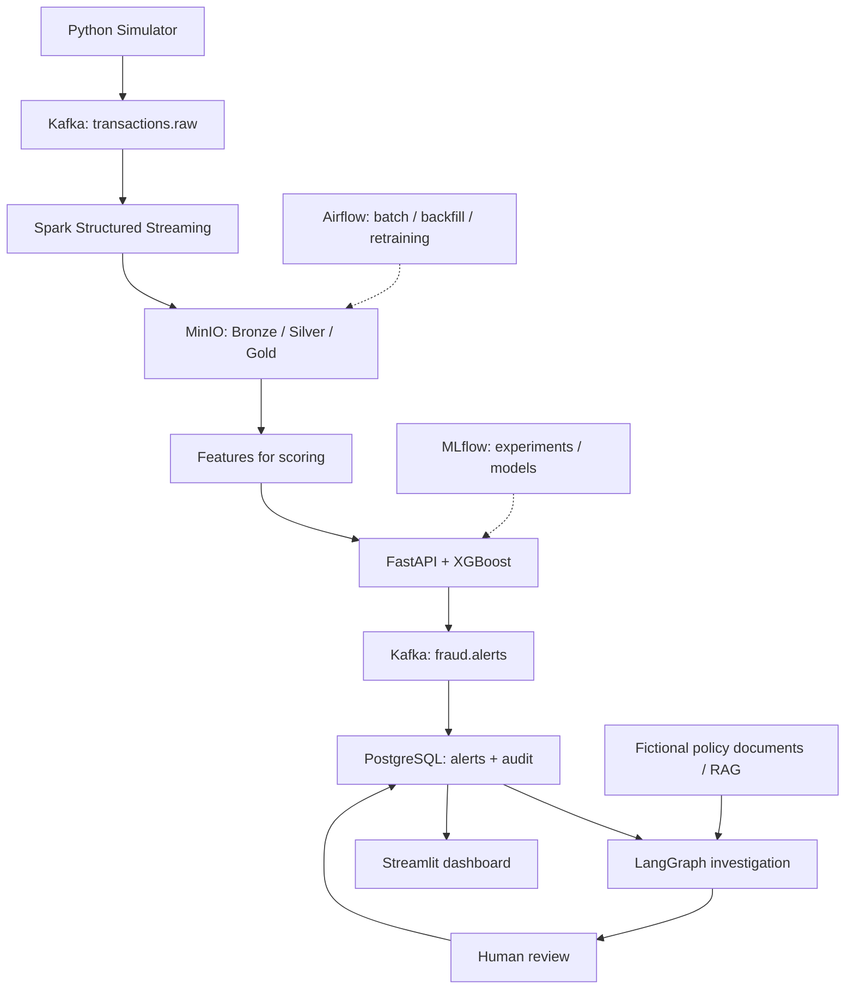

# S10 — Vue d'architecture logique

**Statut :** vue de contexte ; les schémas exacts, responsabilités de livraison et interfaces seront détaillés en S11.  
**Référence :** Cahier des charges v1.0, sections 5–7 ; README, sections 2, 4–6.

## Frontières et responsabilités

- **Événementiel :** Kafka transporte les transactions et alertes. L'ordre, les clés et les contrats v1 seront spécifiés en S11.
- **Analytique :** Spark traite les flux ; MinIO conserve les couches Bronze, Silver et Gold.
- **Prédiction :** le modèle utilise les features disponibles à l'instant du scoring ; le label `is_fraud` n'est jamais une feature.
- **Investigation :** accès à des données limitées en lecture seule, RAG sur corpus fictif avec citations ; aucune action bancaire autonome.
- **Décision :** seuls les analystes valident les alertes ; PostgreSQL garde les états et événements d'audit.
- **Contrôle :** Airflow gère batch/backfill/retraining, non le flux message par message.

## Points ouverts pour S11

1. Contrat d'événement de production vs événements synthétiques labellisés pour l'entraînement.
2. Convention uniforme du nom du score : `risk_score` sauf calibration vérifiée.
3. Clés d'idempotence (transaction + version du modèle), identifiants d'alertes et transitions.
4. Approche de mise à disposition des features Gold pour le scoring temps réel.
5. Emplacement et règles de checkpoint ; stratégie DLQ ; schémas et compatibilité.
6. Schéma de gestion des accès et authentification en staging.

> Ce diagramme montre des responsabilités logiques. Il ne garantit pas une latence temps réel et ne signifie pas que les services existent déjà.
